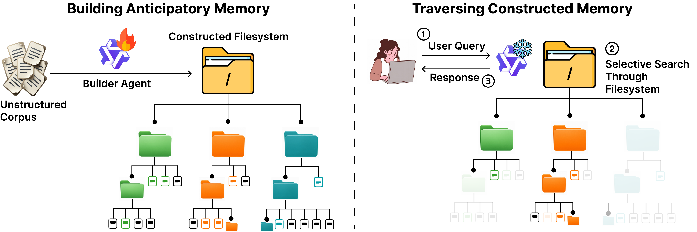

# Librarian Agents



**Librarian Agents: Anticipatory Filesystem Construction via Reinforcement
Learning** trains a builder agent to organize a document corpus into a reusable
hierarchical filesystem before future queries are revealed. An answering agent
then navigates that filesystem to answer queries.


[](https://librarian-agents.github.io/)
[](LICENSE)

## Contents

- [`environments/`](environments/README.md): synthetic-filesystem RL environment.
- [`experiments/`](experiments/README.md): training, answering, and retrieval methods.
- [`data_processing/`](data_processing/README.md): benchmark preparation.
- [`configs/`](configs/README.md): paper configurations.
- [`analysis/`](analysis/README.md): metric computation and statistical summaries.
- [`results/`](results/README.md): compact records for reported results.
- [`scripts/`](scripts/README.md): end-to-end commands.

## Quick Start

Python 3.11 or newer is required.

```bash
python -m venv .venv
source .venv/bin/activate
python -m pip install --upgrade pip
python -m pip install -e '.[builder,dev]'
cp .env.example .env
```

Install `.[baselines]` on a CUDA machine to generate the dense, hybrid,
late-interaction, reranking, GraphRAG, Agentic RAG, and AutoCompaction results.

## Reproduce Reported Results

```bash
scripts/reproduce_results.sh
```

This command recomputes the BrowseComp+ reuse, BRIGHT, and hierarchy-ablation
metrics from the bundled compact score records. End-to-end commands and protocol
details are in [REPRODUCING.md](REPRODUCING.md). Numerical results are summarized
in [RESULTS.md](RESULTS.md), and checkpoint assignments are in
[CHECKPOINTS.md](CHECKPOINTS.md).

## Citation

```bibtex
@article{singh2026librarian,
  title   = {Librarian Agents: Anticipatory Filesystem Construction via Reinforcement Learning},
  author  = {Singh, Anikait and Zhang, Teresa and Lee, Yoonho and Nair, Roshen Sanjay and Kumar, Aviral and Finn, Chelsea},
  year    = {2026}
}
```

## License

Code is released under the [MIT License](LICENSE). Benchmark data remains under
its upstream terms; see [data/README.md](data/README.md) and
[THIRD_PARTY_NOTICES](THIRD_PARTY_NOTICES).
